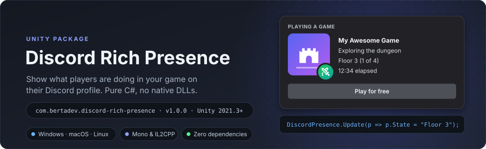
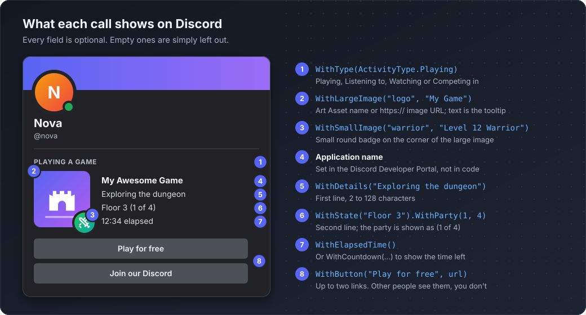
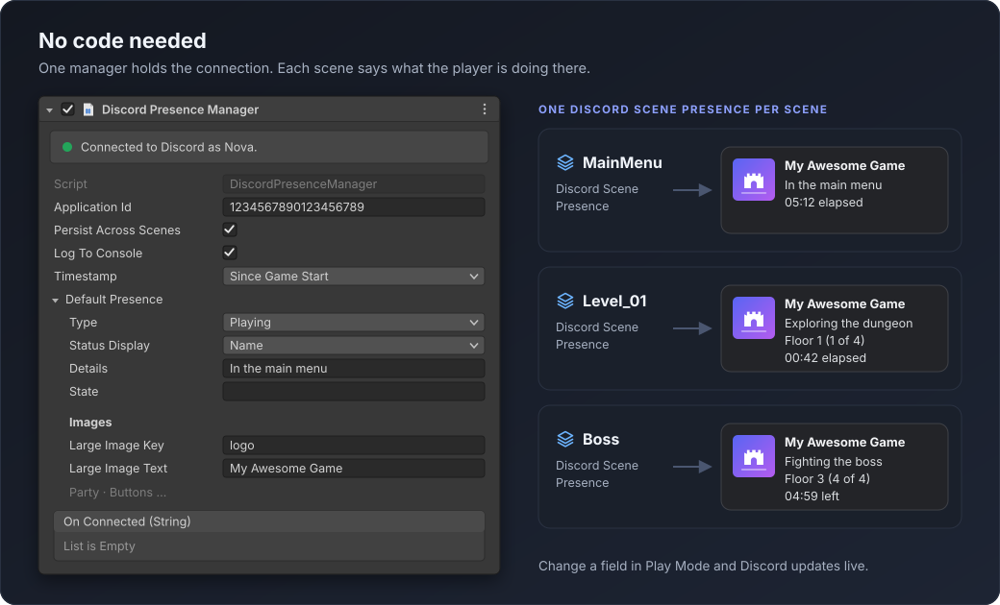
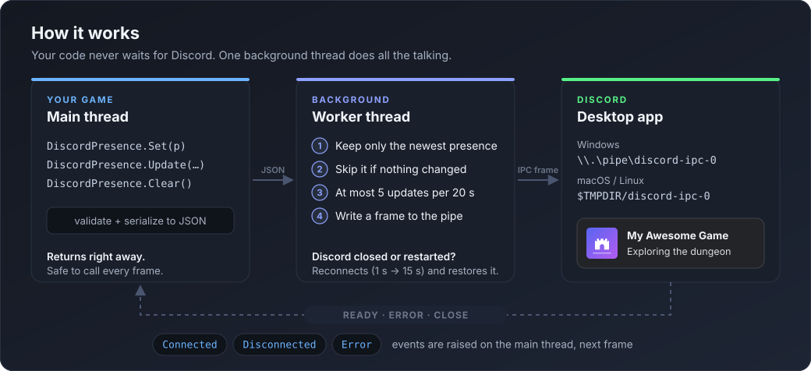
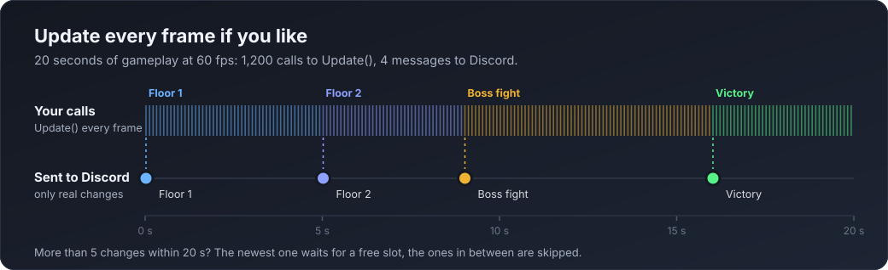

<p align="center">
  
</p>

<p align="center">
  <a href="https://unity.com"></a>
  
  
  <a href="LICENSE.md"></a>
  <a href="https://github.com/BerTaDev/unity-discord-rich-presence/releases/latest"></a>
</p>

<p align="center"><a href="README.md">English</a> · <b>Türkçe</b></p>

# Unity için Discord Rich Presence

Oyuncuların oyununda ne yaptığını Discord profillerinde gösterin. Bağımlılık yok, native DLL yok, bir dakikada kurulur.

```csharp
DiscordPresence.Initialize("UYGULAMA_ID");
DiscordPresence.Set(new RichPresence().WithDetails("Zindanı keşfediyor").WithState("Kat 3").WithElapsedTime());
```

<p align="center">
  
</p>

## Özellikler

- **Saf C#.** Discord masaüstü uygulamasıyla doğrudan yerel IPC (pipe/socket) üzerinden konuşur. Discord SDK yok, native plugin yok, build'in yanına ekstra dosya yok.
- **Editor + Windows, macOS ve Linux build'leri**, Mono ve IL2CPP. Flatpak, Snap ve Vesktop kurulumları da bulunur.
- **Kodsuz kullanım.** İlk sahneye `Discord Presence Manager` koy, her sahneye bir `Discord Scene Presence` ekle, bitti.
- **Hızlı ve sık çağırmaya uygun.** Her şey arka plan thread'inde çalışır, ana thread'i asla bloklamaz. İstersen `Update`'i her frame çağır: yalnızca en son durum gönderilir, aynı olanlar atlanır, Discord'un hız limiti (20 saniyede 5 güncelleme) senin yerine yönetilir.
- **Otomatik yeniden bağlanma.** Discord oyundan sonra açılsa ya da yeniden başlasa bile bağlantı geri gelir ve presence geri yüklenir.
- **Doğrulama.** Discord'un reddedeceği (ve bu yüzden tüm presence'ı sessizce düşüreceği) değerler düzeltilir ya da çıkarılır, Console'a açık bir uyarı yazılır.
- **Canlı düzenleme.** Play Mode'da Inspector'dan presence'ı değiştir, Discord'da anında gör.
- Details, state, büyük/küçük görsel (asset key ya da görsel URL'si), geçen süre ya da geri sayım, parti boyutu, en fazla 2 buton, aktivite tipi (Playing / Listening / Watching / Competing) ve durum gösterim tipi.

## Kurulum

**Window → Package Manager → + → Add package from git URL…**

```
https://github.com/BerTaDev/unity-discord-rich-presence.git
```

Belirli bir sürüme sabitlemek için: `https://github.com/BerTaDev/unity-discord-rich-presence.git#v1.0.0`

## 1. Discord uygulaması oluştur

1. [Discord Developer Portal](https://discord.com/developers/applications) → **New Application**. Uygulamanın adı Discord'da "**ad** oynuyor" olarak görünür.
2. **General Information** sayfasından **Application ID**'yi kopyala.
3. İsteğe bağlı: **Rich Presence → Art Assets** altına görseller yükle (512×512 veya üstü). Görsele verdiğin isim Unity'deki *key*'idir. Yeni görsellerin görünmesi birkaç dakika sürebilir. Key yerine doğrudan `https://` görsel URL'si de kullanabilirsin.

## 2a. Kodsuz

1. **GameObject → Discord → Discord Presence Manager**, Application ID'yi yapıştır.
2. Varsayılan presence'ı doldur (details, state, görsel key'leri…) ve **Play**'e bas.
3. Sahneye göre farklı yazı mı istiyorsun? O sahneye **GameObject → Discord → Discord Scene Presence** ekle.

<p align="center">
  
</p>

Manager bağlantıyı sahne geçişlerinde açık tutar; Play Mode'da Inspector'ı bağlantı durumunu gösterir.

## 2b. Kodla

```csharp
using BerTaDev.DiscordRichPresence;

DiscordPresence.Initialize("UYGULAMA_ID");

DiscordPresence.Set(new RichPresence()
    .WithDetails("Zindanı keşfediyor")
    .WithState("Kat 3")
    .WithLargeImage("logo", "Oyunum")
    .WithParty(1, 4)
    .WithElapsedTime()
    .WithButton("Ücretsiz oyna", "https://example.com"));

// Sadece değişeni güncelle, gerisi aynı kalır.
DiscordPresence.Update(p => p.State = "Kat 4");

// Presence'ı kaldır (bağlantı açık kalır).
DiscordPresence.Clear();
```

Oyun kapanınca bağlantı otomatik kapanır ve presence temizlenir.

## Nasıl çalışır

<p align="center">
  
</p>

`Initialize` tek bir arka plan thread'i başlatır. Bu thread Discord'un IPC ucunu bulur (Windows'ta `\\.\pipe\discord-ipc-0..9`, macOS/Linux'ta geçici dizindeki `discord-ipc-0..9`), handshake yapar ve bekler. `Set` ya da `Update` çağırdığında presence ana thread'de JSON'a çevrilip devredilir; thread yalnızca en yenisini gönderir, değişmediyse atlar ve hız limitine uyar. Discord kapalıysa 1 saniyeden 15 saniyeye kadar artan aralıklarla yeniden dener, bağlanınca mevcut presence'ı tekrar gönderir.

<p align="center">
  
</p>

Yani "bu değişti mi?" diye takip etmene gerek yok: `Update`'i ne zaman işine gelirse, istersen her frame çağır.

## Sorun giderme

- **Hiçbir şey görünmüyor.** Discord *masaüstü* uygulaması açık olmalı (tarayıcı sürümünde RPC yok). Discord'da **Kullanıcı Ayarları → Etkinlik Gizliliği → Algılanan etkinliklerini başkalarıyla paylaş** açık olmalı.
- **Console'da "Invalid Client ID".** Application ID yanlış.
- **Görseller çıkmıyor.** Key, Developer Portal'daki asset adıyla birebir aynı olmalı. Yeni yüklenen görseller ~10 dakika sürebilir; URL'ler anında çalışır.
- **Butonlar görünmüyor.** Discord kendi butonlarını sana göstermez, başka bir hesaptan bak.
- **Windows'ta hiç bağlanmıyor.** Unity ve Discord aynı yetkiyle çalışmalı; biri "Yönetici olarak çalıştır" ile açıldıysa birbirlerini göremezler.
- **Güncellemeler gecikiyor.** Discord 20 saniyede 5 güncellemeye izin verir; en son durum izin çıkar çıkmaz gönderilir.

Tüm API için [İngilizce README](README.md#api)'ye bak.

## Lisans

[MIT](LICENSE.md) © BerTaDev. Discord Inc. ile bağlantılı değildir.
